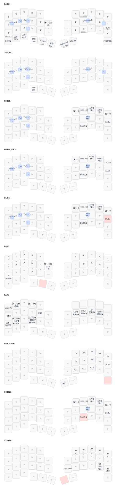

# zmk-config-roBa

[](keymap-drawer/roBa.svg)

[配置図を直接開く](keymap-drawer/roBa.svg) · [生成された配置データ](keymap-drawer/roBa.yaml)
画像・本文・keymapは、閲覧中の同じブランチの内容です。

`iwashita-nozomu/zmk-config-roBa` の個人用配置です。**ホストの配列はJIS（日本語）を前提**とします。
配置の正本は [config/roBa.keymap](config/roBa.keymap)、変更理由・検証結果は
[追跡Issue #226](https://github.com/iwashita-nozomu/project_template/issues/226) に記録します。
PR公開やビルド成功は実機への適用とは別です。書き込み後には、ZMK Studioの保存設定も含めて
実際の割り当てを確認してください。確認のためにペアリング情報を消去しないでください。

## 基本操作

位置名は通常レイヤーの文字、番号は0始まりです。

| 位置 | タップ／通常操作 | 保持中 |
| --- | --- | --- |
| 左親指、Space左 (37) | IME切替＋MOUSE解除（押下時） | Shift兼用なし |
| Z (22) | z | 約250msでShift。単独保持の解放後は200msの1打猶予 |
| Space (38) | Space | NUM |
| 左親指の一番右 (39) | 無入力 | 200ms保持でNAV、離すと解除 |
| Enter左の右親指 (40) | Esc | 200ms保持でSYSTEM（位置・判定時間は維持） |
| 右親指 (41) | Enter | 200ms保持でFUNCTION、解放で解除 |
| 右下 (42) | Backspace専用 | 長押しの連続削除。レイヤー兼用なし |
| U (6) | 通常層ではU | MOUSE_HOLD。マウス中は押下から保持 |
| J＋K (18/19) | BASE/IME_ALTで同時押しするとMOUSE_HOLD | 両方を離すまで。マウス中の同時押しは中クリック |
| N (29) | N | 通常のNリピート。スクロール兼用なし |
| M (30) | 通常層ではM | SCROLL。マウス中は押下から有効 |
| P直下の引用符キー (21) | 通常層では `'` | 通常層からもSLOW。マウス操作中は押下から有効 |
| H左隣の `-` (16) | 普通の `-` | スクロール兼用を撤去 |

**Nのスクロール役割をM位置へ移しました。文字のN/Mは交換していません。**
通常速度の手動入口はU保持とBASE/IME_ALTのJ＋Kです。Mはスクロール担当です。
通常Uは標準hold-tap、M/引用符・Space/Esc(40)/Enter(41)は標準layer-tapで、200ms・tap-preferred判定を使います。
タップは文字等、ホールドは各レイヤーです。マウス中Uは共有保持behavior、M/引用符は標準 `&mo` で即時保持します。
右下(42)は `&kp BACKSPACE` です。Fnの保持をEnter(41)へ移したため、押下時から削除し、長押しで連続削除できます。
左親指IMEは押下でIMEを切り替える専用キーです。ShiftやSYSTEMには入りません。

保持解除はそのレイヤーだけを外し、ほかの保持状態やIME送信順をリセットしません。
解放後の**新しい押下**が残ったレイヤーで解決されます。既に押下中のキーを途中で別のHIDキーに
変換する動作ではありません。通常U保持はMOUSE_HOLD、M保持はSCROLL、引用符保持はSLOWです。

Ctrl・GUI (Win/Command)・Altの専用キーは維持しています。
H/I/Nは通常層で普通の文字キーです。Zは下記のShift兼用です。削除コンボは追加していません。
**EscをEnter左の40へ、Fnの保持をEnter41へ移しました。右下42はBackspace専用です。**
SYSTEMの保持は40、NAVの保持は39のままで、どちらも200msの判定を維持します。
Escが移った39は短押し無入力／200ms保持NAVです。標準hold-tapのtap側を`&none`にし、NAVを即時化しません。
DeleteはEnter41を約200ms保持してFUNCTIONへ入り、右下Backspace42を押します。旧Delete40は透過へ戻したため、Fn中も40のEsc/SYSTEMを使えます。
Enterは単独キーからタップ兼用へ変わり、短く押して離したときにEnterを送ります。ZのShift250ms／猶予200msは変更していません。

### ShiftとZ

**ShiftはZ位置(22)に集約し、親指37のShift兼用は撤去しています。**
通常層でZを250ms未満で離すとz、約250ms保持するとShiftです（tap-preferred）。
別キーを押しただけでは長押しへ早期確定せず、保持中は通常のShiftとして使います。

**Zを単独で長押しして離した後は、200msだけ次の1打を待ちます。**
その間にZを押し直せばShift+Z、AならShift+Aです。次の非修飾キー押下で猶予を使い切り、
何も入力しなければ期限で解除します。2文字目を巻き込まないようquick-releaseを使用します。
Z保持中に既に文字や矢印へShiftを使った場合は、Z解放で解除し、猶予を残しません。
Ctrl/GUI/Altの押下だけは猶予を消費せず、Ctrl+Shift+Z等と組み合わせられます。

```text
z:        Zを短く押して離す
Shift+A:  Zを約250ms保持し、そのままAを押す
Shift+Z:  Zを単独で約250ms以上保持 → 離す → 200ms以内にZを押し直す
```

長押し判定は200msから250msへ延長しました。解放後の200ms猶予とは別の設定です。Shiftが有効な間のZはmod-morphで
長押し再判定を通さず文字入力へ進み、keep-modsでShiftを隠しません。quick-releaseなので、
猶予を消費した後も押し続けたキーのリピートがすべて大文字になるとは保証しません。
250msの保持判定と200msの猶予の境界、USB/BLE/ホスト処理の遅延は実機確認が必要です。

マウス中も同じZ長押しを使い、**Shift保持だけでは自動MOUSEを解除しません**。
Zの文字入力が確定した分岐だけが自動MOUSEをOFFにしてZを送ります。手動U/M/SLOWは残します。
Z/Shiftの保持だけでは自動MOUSEの期限を延長しませんが、I/O・J/Kの操作は延長し、保持中はタイムアウトしません。
Sticky Keyが使用済みかを判断する対象はキーボードのキーコードです。クリックだけにShiftを
使った場合は、解放後に200msの猶予が残る点に注意してください。

実装は標準hold-tap、sticky-key、mod-morphと2つの押下/解放マクロです。独自Cタイマーはありません。
採用版hold-tapは解放にも最初の押下時刻を渡すため、そのままsticky-keyへつなぐと
猶予の期限が古い時刻になります。`shift_hold`を標準behavior queueへ通して実行時刻を渡し、
解放処理から200msを測ります。キューが他のマクロを待つ場合、その配送分の遅延は残ります。
`z_tap`も固定時間のキー連打ではなく、実際の押下/解放を転送します。

NUM中はZ位置の「0/Shift」（既存balanced判定）、NAV中は同位置の専用Shiftを維持しています。
これらには新しい解放後猶予を追加していません。範囲選択はNAV(39)を保持してから
Z位置のShiftとHJKLを使い、Shift+Tabには既存のD+Fコンボも使えます。

根拠: [ZMK Hold-Tap](https://zmk.dev/docs/keymaps/behaviors/hold-tap)、
[Sticky Key](https://zmk.dev/docs/keymaps/behaviors/sticky-key)、
[Mod-Morph](https://zmk.dev/docs/keymaps/behaviors/mod-morph)、
[採用版behavior queue](https://github.com/zmkfirmware/zmk/blob/acfd8e5ea76cf23ad1c9b6b99848f97a95224257/app/src/behavior_queue.c)。

### NAV・EscとTab

**EscのタップはEnter左の40です。左親指の一番右39はタップ無入力／保持NAVになりました。**
39は200msの保持判定でNAVへ入り、離すとNAVだけを解除します。40は短いタップでEsc、200ms保持でSYSTEMです。
専用変換 `INT_HENKAN` は以前の39から撤去したままで、今回別位置には追加していません。
親指38のSpace/NUMと、親指37のLANG切替専用キーは維持しています。

Enter41は短押しEnter／保持Fnです。200msの保持判定後にFUNCTIONを有効にし、解放でその層だけを解除します。
右下42はBackspace専用です。Tabは既存のS+D、Shift+TabはD+Fです。J+Kは通常時のマウス入口とマウス中の中クリックに分けます。

## 時間条件と操作の有効範囲

自動MOUSEの無操作待ちは500msです。Fnの保持はEnter41へ移して200ms判定を維持し、Esc/SYSTEM40・NAV39も200msのままです。右下Backspace42には保持判定がありません。Z保持250ms、解放後のShift猶予200msは変更していません。設定時間はOSまでの応答時間の保証ではありません。
採用ZMK `acfd8e5` の標準定義・処理と、このリポジトリの本番Cを照合しています。

| 対象 | 時間条件 | 何が有効になるか・終わるか |
| --- | --- | --- |
| 通常U/M/引用符、Space/Esc(40)/Enter(41) | hold-tap、200ms、tap-preferred | 短い解放で文字等、保持判定で各レイヤー。別キーの押下だけでは早期holdしない |
| 通常ZのShift | 250ms、tap-preferred、quick-tap=0 | 保持でShift。単独保持の解放処理から200msだけ次の1打を待ち、1打で解除 |
| 親指37のIME | 長押し判定なし | 押下時にLANG切替。保持でShiftへ変化しない |
| NUMの0/Shift | 200ms、balanced、quick-tap=0 | 200ms保持、または他キーを押して離すまで0を保持するとShift。単なる他キー押下だけでは未決定 |
| マウス中U/M/引用符 | 長押し判定なし | Uは共有保持、M/引用符はmo。自動MOUSEの期限から独立 |
| NAV(39) | hold-tap、200ms、tap-preferred | 短押し無入力、保持でNAV、解放でNAVのみ解除 |
| 全7コンボ | 1キー目から2キー目まで50ms未満 | BASE/IME_ALTのJ+K入口のみslow-releaseで両方の解放を待つ。マウス中J+Kの中ボタンと既存5コンボは片方の解放で終了 |
| 自動MOUSEへの入口 | 非ゼロXYの継続200ms以上かつ累積32カウント以上、報告間隔80ms以下、最後のキーコード押下から300ms以上 | 新しいXY報告が条件を満たすと有効化を要求。200msと300msは加算する待ち時間ではない |
| 自動MOUSEの保持 | 最後の非ゼロXY・縦横スクロール・マウス用キー操作／解放から500ms | マウス用キーまたは手動ポインティング層の保持中はタイムアウトしない。通常文字・明示解除を優先 |
| LANGマクロの送信 | wait-ms=0、tap時間は標準30ms | 親指37の押下でLANGを1回送る。Zの250ms判定とは独立 |

**使い方と境界上の注意**

- **Enter左のEsc(40)を長く押すとSYSTEM、Enter(41)を長く押すとFUNCTIONです。** U/M/引用符/Space/Esc(40)/Enter(41)は、
  そのキーを長押しして文字をリピートする配置ではありません。通常N/Backspaceはこの200ms判定を持ちません。Zは上記のShift兼用です。
- **Shift+ZはZの単独長押し→解放→200ms以内の押し直し**です。親指37はIME専用です。
  一方、Uを短く押してIを重ね、200ms未満でUを離す操作は、マウスが別途有効でなければ通常のU/I入力です。
- **300msは最後の解放からではありません。** 長い文字キー保持やOSのリピートを追跡しないため、キーを保持したままでも
  300ms経過後の継続XYで自動MOUSEへ入り得ます。A+Sなどキーコードを出さない操作は予約取消し・継続リセットを行いますが、
  idle時計は更新しません。直後の新しい200msの継続XYが移動量条件も満たすと、再び有効になる場合があります。
- **SLOWを離しても自動MOUSEが残る場合があります。** 自動入口を抑止するのはU/J+KのMOUSE_HOLDです。
  SLOWだけの保持中はXYで自動MOUSEも有効になり得ます。有効化済みAUTOは手動保持中も残り、最後の操作・保持解放から0.5秒後に解除します。
- **クリック・スクロールを続ければ自動MOUSEを維持します。** 無操作時間が0.5秒未満の間は期限を更新し、
  I/O・J/Kなどのマウス用キーを押している間はタイムアウトしません。最後の操作・保持解放から0.5秒が基準です。
  自動層が既に外れた後の新しいI/O押下は文字側であり、それだけでMOUSEへ再入場しません。
- **コンボは「常に現在層を再確認」ではありません。** 1キー目で最高位層から候補を作り、2キー目は位置と期限で絞ります。
  J/Kの1キー目から保持を追跡するため、認識待ち中の自動タイムアウトは防ぎます。ただし、明示解除や
  手動層変更で候補が途中の層変化をまたぐ標準コンボの性質は残ります。中ボタンは片方の解放で外れますが、
  自動MOUSEの保持はJ/Kの両方を離してから0.5秒です。
- **境界ちょうどを狙わないでください。** この版のコンボは差が50msなら失効します。hold-tapは設定した保持時間を超えた解放も補正しますが、
  設定値ちょうど（Zは250ms、ほかの兼用キーは200ms）の解放はタイマー処理との順序に依存します。自動側の200/80/300ms境界は本番Cで検査していますが、
  work実行・入力配送・USB/BLE・ホスト処理の遅延まで一定時間に制限するものではありません。

根拠: [採用版hold-tap](https://github.com/zmkfirmware/zmk/blob/acfd8e5ea76cf23ad1c9b6b99848f97a95224257/app/src/behaviors/behavior_hold_tap.c)、
[採用版combo](https://github.com/zmkfirmware/zmk/blob/acfd8e5ea76cf23ad1c9b6b99848f97a95224257/app/src/combo.c)、
[自動所有](src/motion_dwell.c)、[継続時間述語](src/motion_dwell.h)。
これらはソース・本番Cの順序制御モデルに基づく監査です。実機のhold-tap/コンボ/HID/IME結果は未検証で、
入口の時間値200/80/300msは維持し、無操作待ちだけ500msにしています。連続操作の期限更新・保持判定は本番Cのままです。再現条件と観測は追跡Issue #226に記録します。

## MOUSE / MOUSE_HOLD / SCROLL / SLOW

| 位置 | マウス操作中の出力 |
| --- | --- |
| Y / P | Ctrl+C / Ctrl+V |
| U | 保持でMOUSE_HOLD |
| **I / O** | **左／右クリック (MB1/MB2)** |
| **J＋K** | **ホイール（中）クリック (MB3)** |
| **M / P直下の引用符キー(21)** | **保持でSCROLL／保持でSLOW** |

**自動切替と、次の手動入口があります。**

- **自動**：非ゼロのXY移動が200ms以上続き、同じ連続操作の累積が32カウント以上で、最後のキーコード入力から300ms以上経過した場合。
  移動報告の間隔が80msを超えると最初から数え直します。触れて止めたあと、待つだけでは入りません。
- **U保持**：通常層のU(6)を200ms保持してMOUSE_HOLDへ入ります。ボール操作は不要です。
  短いタップはU。マウス中のUは押下から保持できます。MからMOUSE_HOLDには入りません。
- **J＋K入口**：BASE/IME_ALTでJ(18)とK(19)を50ms未満の間隔で同時押しします。
  コンボ成立時にMOUSE_HOLDへ入り、両方を離すまで保持します（slow-release）。ボール移動量は不要です。
  入っただけでクリックは送りません。通常のJ/K単独は文字ですが、この同時押しは文字ではなく入口になります。
- **低速保持**：P直下の引用符(21)を通常層から200ms保持するとSLOWへ入り、離すとSLOWだけ解除します。
  短いタップはJISのシングルクォート。Mと組み合わせると低速スクロールです。

### 自動入口の移動量

**時間と移動量の両方を満たすことが必要です。** `mouse_dwell` の `min-distance = <32>` は
低速scaler前のX/Y報告の絶対値の合計、すなわち `Σ(|Δx| + |Δy|)` のしきい値です。
画面の32ピクセルやボール表面の32mmではありません。X/Yの分割報告・往復移動も合算します。
これは方向に完全に依存しないユークリッド距離ではなく、整数の入力移動量です。
32は未校正の初期値で、値を上げるほど入口で必要な操作量が増えます。

200ms未満の大きな一振り、または200msを超えても累積32未満の操作では、自動MOUSEに入りません。
80msを超える報告間隔や既存の打鍵・解除・層変化によるリセットでは、時間と移動量を両方破棄します。
入力ゼロやホイールは入口の移動量へ加算しません。累積はしきい値で飽和させ、長い操作や極端な負の値でも桁あふれを防ぎます。
ただし、長く続く細かい往復も累積するので、誤接触そのものを識別する機能ではありません。

**移動量条件は新規自動入口だけです。** 有効化後の1カウントの微調整、クリック、縦横スクロール、
保持・解放による継続は従来どおりで、毎回32カウントを要求しません。U保持の手動入口も変更しません。
カーソルの移動自体は止めません。入口・更新とも既存の単一経路で処理し、別タイマーや旧driver自動制御を追加しません。

### 連続操作中の保持と、操作終了後の0.5秒

**自動MOUSEは、操作が続く間は維持し、最後の操作・保持解放から500msで解除します。**
非ゼロXYと縦横スクロール、有効なポインティング層で押したY/U/I/O/P・J/K・M・SLOW位置が対象です。
クリックの連打だけでも期限を更新し、ドラッグのようにボールを止めてIを長く保持する場合も切れません。
マウス用キーが複数押されている場合は最後の解放から0.5秒です。Ctrl/GUI/Alt/Zの保持だけでは延長しません。

U/J+KのMOUSE_HOLDは最後の保持を離すと解除します。MのSCROLL、SLOWも自分の保持を離すとその層だけ解除します。
これらの手動層が保持されている間、有効化済みのAUTOもタイムアウトしません。
SLOWへ先に入ってからAUTOが重なった場合も同じです。手動操作だけでAUTOを新設することはなく、
MOUSE_HOLD中は従来どおり新しい自動入口を抑止します。

生の押下と解放を追跡するため、J+Kの50ms未満の認識待ちも保護します。押下時に最高位が
NUM/NAV/FUNCTION/SYSTEMだった同じ位置のキーは、クリックの保持として登録しません。
登録済みの保持は途中で層が変わっても対応する物理解放で終えます。
通常文字、IME、A+S等の解除は保持より優先し、解放だけでAUTOを復活させません。
解除後に改めてXYの入口条件を満たした場合は新しい自動セッションであり、まだ実際に保持している
マウスボタンはそのセッションでも保護します。HIDのボタン解放そのものを書き換える処理ではありません。

**Uを保持したままIを押すと左クリックでき、I保持＋ボール操作でドラッグできます。**
U保持中のOは右クリック、J+Kは中クリックです。J+Kで入ってからUを押し、J/Kを離してもI/Oクリックを使えます。
標準moは個々の解放で層を無条件にOFFにするため、UとJ+Kの併用にはそのままでは適しません。
[mouse_hold](src/behavior_mouse_hold.c)はこの1つの手動層の保持数のみを管理し、最後の解放でOFFにします。
通常Uは標準hold-tapから同じownerを呼びます。別タイマーや新レイヤーは追加せず、SLOW/SCROLLは別の保持です。
この変更は入口が1つから2つになったためであり、廃止済みの汎用shared_moや旧マウス配置は復活させません。
SLOWを離しても、自動MOUSE等が残っていればその状態へ戻ります。

通常状態からMを保持すれば直接SCROLLにも入れます。M→引用符でも引用符→Mでも低速スクロールです。
NUMのU/引用符/N/Mは&/%/[/]、NAVのUは無入力、FUNCTIONではF2/F10/F11/F12を維持します。
Nはマウス中も文字入力に戻れるキーで、スクロールを開始しません。

### J＋Kの中クリック

マウス層（MOUSE/MOUSE_HOLD/SLOW/SCROLL）でJ(18)とK(19)を50ms未満の間隔で同時押しすると
中ボタンを押下します。**どちらか一方を離すと中ボタンを解放**する標準コンボです。
両キーを離すまで保持する `slow-release` や固定トグルは使いません。
マウス中のJ/K単独は `&none` で、コンボ不成立時に文字を漏らしません。
生のJ/K押下で先に自動MOUSEが解除されないよう、両位置を解除除外に含めています。

通常層のJ/K単独は普通の文字、同時押しは上記のマウス入口です。NAVのJ/Kは下／上矢印です。
NUM/NAV/FUNCTION/SYSTEMが最高位のときはこのコンボを発動させません。
コンボ・hold-tapの実際のイベント順序と押し心地は実機確認が必要です。

根拠: [ZMK Combos](https://zmk.dev/docs/keymaps/combos)。

200/80/300msは実機調整用の初期値です。動きの連続性はセンサーの移動報告で判定し、手の接触や
使用者の意図を直接検知しません。キーを長く保持している状態やホスト側キーリピートは、
最後のキーコード押下時刻だけでは追跡できません。カーソル移動自体は抑止しません。
Mac画面操作ショートカットは追加していません。

| 保持中 | ボールの動作 |
| --- | --- |
| なし | 通常カーソル移動 |
| P直下の引用符キー | 低速カーソル移動 |
| M | 通常スクロール |
| M＋P直下の引用符キー | 低速スクロール |

MOUSE中からMとP直下キーをどちらの順で押しても組み合わせられます。
両方保持した状態からP直下キーだけ離すと通常スクロール、Mだけ離すと低速カーソル移動へ戻ります。
保持中SCROLL/SLOWのI/OクリックやM・P直下キーの入口は文字に落ちません。AUTOの明示解除でも手動層は消しません。
4つのレイヤーのbindingsは `POINTING_BINDINGS` を共有し、内容を二重管理しません。

低速倍率は入力移動量の **1/4** です。`trackball_listener` のSLOW overrideでZMK標準の
`zip_xy_scaler 1 4` と `zip_scroll_scaler 1 4` を使い、通常のCPI・OS設定は変更しません。
XYと縦横ホイールそれぞれの端数を標準実装が保持します。小さい入力を毎回捨てる設定ではありません。
端数はキーを離すと消す独自処理を追加せず、標準scalerのまま次の低速入力へ持ち越します。

既存PMW3610のSNIPEとSCROLLは排他的なので、SNIPEは使いません。
SLOWをSCROLLより下位に置き、listenerはSLOWが**有効かどうか**で倍率を選びます。
このためSCROLL中にも低速が効き、低速キーを押すことでスクロールがカーソル移動へ化けません。
NUMのN/Mは角括弧、FUNCTIONのN/MはF11/F12を維持します。P直下キーもNUMでは%、
NAVでは引用符、FUNCTIONではF10が優先します（別途SCROLLを保持した場合はポインティング優先）。
L+引用符のダブルクォートコンボはBASE/IME_ALT限定とし、MOUSE/SLOWで低速ホールドを奪わないようにしています。

倍率は画面上の速度の厳密な1/4を保証しません。OS加速やアプリのスクロール処理も影響します。
スクロールは既存ドライバの整数ホイールイベントを縮小するため、同方向では概ね4イベントごとに
1イベントを出す方式です。高解像度の滑らかなスクロールを新設したわけではありません。
クリックは押している間ボタンを保持し、ドラッグに使えます。

根拠: [ZMK scaler](https://zmk.dev/docs/keymaps/input-processors/scaler)、
[採用ZMKのscaler定義](https://github.com/zmkfirmware/zmk/blob/v0.3-branch/app/dts/input/processors/scaler.dtsi)、
[listenerの有効層判定](https://github.com/zmkfirmware/zmk/blob/v0.3-branch/app/src/pointing/input_listener.c)。

### キータップで文字入力へ戻る

通常の文字・記号、Space/Esc/Tab/Enter/BackspaceやFn等を押すと**自動MOUSEだけ**を解除します。
最初のキーイベントも後続へ渡し、解除のためだけに1打を捨てる方式にはしません。
生押下で解除しない位置はYUIOP(5–9)、中クリックJ/K(18/19)、低速21、Z/Shift22、スクロールM30、Ctrl/GUI/Alt(34–36)です。
ZはShift保持では解除せず、文字入力の分岐で自動MOUSEを解除します。親指37は押下でMOUSE解除＋LANG入力を実行します。
A＋Sの明示解除も残し、入力言語やLANG送信順を変えません。H/L/Nは通常文字なので解除対象です。
MOUSE中のYUIOP・J/K・M・引用符から文字入力を始める場合は、まず明示解除するかタイムアウトを待ちます。

NUM/NAV/FUNCTION/SYSTEMやIME送信順は消しません。保持中のMOUSE_HOLD/SCROLL/SLOWも残るため、
文字入力に完全に戻る際はU/J+K/M/低速の保持を離してください。全層を消す `&to 0` は使いません。

自動MOUSEの継続判定・入力休止・取消し・保持期限は [motion_dwell.c](src/motion_dwell.c) が一括管理します。
PMW3610側の `automouse-layer=0` と、不要になったドライバの自動設定の撤去は維持します。
標準 `zip_temp_layer` への委譲は廃止し、自動制御を二重に動かしません。
速度変換・hold-tap・コンボの判定はZMK標準です。U/J+Kの手動MOUSE_HOLD所有だけを専用behaviorにまとめます。

遅延処理は過去のON/OFF要求をキューに積まず、1つのZephyr delayable workで**現在の要求と最新の期限**を確認します。
生押下による解除対象キーは、既に有効な自動MOUSEだけでなく、まだ実行していない有効化要求も取り消します。
Zは判定後の文字キーコードで保留要求も取り消すため、長押し未確定中の生押下は取消し対象ではありません。
有効化する時点でも入力休止とMOUSE_HOLDを確認し、取消し後に時間だけが経過しても復活させません。
古いタイムアウト処理が残っていても、移動・スクロール・マウス用キーで延長された最新期限を確認します。
保持ビットまたは手動ポインティング層が有効な間は無操作解除をせず、解放通知で期限を再設定します。
保持中を調べ続けるポーリングや第二のタイマーは追加していません。
状態確認と変更は同じ再入可能なmutex内で行い、同期的なレイヤー通知にも対応します。

コンボやhold-tapが押下を捕捉する前に取消しを処理するため、CMakeでこのlistenerを `app` の先頭側へ登録します。
A＋Sのように文字キーコードを送らない操作でも予約を取り消せます。キーイベントそのものは消費しません。
移動が途切れたとき、キーコード押下時、レイヤー変化時に継続判定をやり直します。
低速overrideも同じ入口をスケーラーの前に通し、500msはkeymapの `AUTOMOUSE_PROCESSOR` に一度だけ定義します。
入口200/80/300ms・移動量32・レイヤー番号・解除除外は維持し、無操作待ちだけ500msです。

根拠: [Zephyr Work Queues](https://docs.zephyrproject.org/latest/kernel/services/threads/workqueue.html)。
再スケジュールしても既にキューに入ったworkは取り消されないため、取消しフラグと最新期限を実行時の判断基準にします。

### ターミナルでのCtrl+C/V

Y/Pは「ターミナルではマウスを使わない」という利用方針でCtrl+C/Vを維持します。
生のCtrl+CがTTYへ届けば通常はSIGINTで前景ジョブを中断し、Ctrl+Vもzshの標準Emacs編集では
quoted-insertで、貼り付けとは限りません。端末へ移った直後はA＋SでMOUSEを解除し、U/MとP直下の低速キーも離します。
WezTerm標準のクリップボード操作はCtrl+Shift+C/V（macOSではCommand+C/Vも）ですが、
全GUIアプリへそのまま適用できるわけではありません。Ctrl/Commandの自動変換はしていません。

根拠: [TTY特殊文字](https://sourceware.org/glibc/manual/latest/html_node/Special-Characters.html)、
[zsh](https://zsh.sourceforge.io/Doc/Release/Zsh-Line-Editor.html)、
[WezTerm](https://wezterm.org/config/default-keys.html)。

## NAV / FUNCTION

**左親指の一番右(39)は、短押し無入力、ホールド中だけNAVです。EscはEnter左40へ移しました。**
Space/NUM(38)は変更していません。NAV入口は `&nav_hold L_NAV 0` で、標準hold-tapの
200ms・tap-preferred判定を使い、tap側を`&none`にしています。即時の `&mo` ではないため、矢印操作はホールド判定後に行います。
39の短いタップや保持解放では文字キーを送らず、保持解放でNAVだけを解除します。
NAV中のH/J/K/Lは左/下/上/右です。
Y/U/I/O/Pは `&none` で、文字も下位MOUSE/NUMの操作も送りません。
Home/End、Ctrl+Tab、Ctrl+Shift+Tab、GUI+Shift+左右矢印、エンコーダーのCtrl+PageUp/PageDownは維持。
NAVを離すと残ったレイヤーの割り当てへ戻ります。

FUNCTIONはEnter(41)を約200ms保持してから解放まで有効です。短いタップはEnterを送ります。
その左のEsc(40)は短押しEsc／保持SYSTEMで、標準layer-tapの200ms・tap-preferred判定を使います。

```text
通常の位置:  Y    U    I    O    P
FUNCTION:   F1   F2   F3   F4   F5

通常の位置:  H    J    K    L    '
FUNCTION:   F6   F7   F8   F9  F10

通常の位置:  N    M    ,    .    /
FUNCTION:  F11  F12  F13   透過  透過

右下Backspace位置 (42): Delete
右親指Enter (41): 短押しEnter / 200ms保持でFUNCTION
```

Fnを離した後の新しい42の押下はBackspaceへ戻ります。NUMを同時に保持していた場合、N/M/COMMAはNUMの括弧へ戻ります。
FUNCTION40は透過なので、Fn中もEsc/SYSTEMを使えます。SYSTEMとFUNCTIONはどちらから保持しても入口を塞ぎません。
SCROLLを別途保持している間は、U保持・I/OクリックとM・P直下キーのポインティング操作をFUNCTIONより優先します。

## SYSTEM：右手に集約

**Enter左の右親指40は短押しEsc、200ms保持でSYSTEMです。SYSTEMの保持位置・判定時間は変更していません。**
右親指41はEnter/Fn、右下42はBackspace専用です。FUNCTION中の42でDeleteを出します。
SYSTEM入口は40、FUNCTION入口は41で、ともに右手です。
両入口は互いの層で透過なので、SYSTEMとFUNCTIONをどちらから保持しても、残った保持を個別に解放できます。
左親指IMEは専用キーで、ShiftやSYSTEMには入りません。設定への入口を含め右手側に集約しています。

| SYSTEM中の右手位置 | 動作 |
| --- | --- |
| Y/U/I/O/P | Bluetoothプロファイル0/1/2/3/4を選択 |
| H/J/K | 既存の数字1/2/3送信（旧X/C/Vから移設） |
| N左隣 (28) | bootloader |
| `.` (32) | **全Bluetoothペアリング情報を消去** |
| `/` (33) | 選択プロファイルのペアリング情報を消去 |

数字1/2/3は普通のキー送信で、CPI設定などの新機能ではありません。
SYSTEMの左手位置には専用の設定割り当てを置かず透過にします。
Esc/SYSTEM40とEnter/Fn41は200msの保持判定です。保持が成立したら、解放時にはEsc/Enterを送りません。
SYSTEMからの戻りは40、FUNCTIONからの戻りは41を離すだけで、IME送信順や他の保持レイヤーをリセットしません。
**bootloaderとペアリング消去は通常入力ではありません。検証のために実行しないでください。**

## NUM：数字とShift記号

数字の並びはテンキー型のまま、送信はテンキー用 `KP_NUMBER_*` ではなく通常の
数字列 `NUMBER_0`〜`NUMBER_9` です。NUMはSpaceホールド、ShiftはZ位置のホールドを使います。
NUM中のZ位置はタップ0／ホールドShiftのままです。

```text
物理位置:  W E R    S D F    X C V    Z
NUM数字:   7 8 9    4 5 6    1 2 3    0（保持はShift）
```

**数字も専用記号も、JISとして認識するホストに合わせています。**
半角・ローマ字入力でのShift数字は次の対応です。

```text
数字:        1  2  3  4  5  6  7  8  9
Shift記号:   !  "  #  $  %  &  '  (  )
```

0とShiftは同じ物理キーなので、そのキーだけでShift+0は押せません。
JISの閉じ丸括弧はShift+9、または専用のNUM+Pを使えます。
NUMのG右隣(15)にあるCtrl+Alt+テンキー0は別の既存ショートカットとして維持します。

## 記号：JISのShift組合せ

NUMはSpaceホールド、NUM中のShiftはZ位置のホールドです。
**NUM+Jで@、NUM+Shift+Jでバッククォート**を出します。バッククォート用の新キーは追加しません。
表はホストがJIS配列として解釈し、半角入力している場合の対応です。

| 操作位置 | Shiftなし | Shiftあり |
| --- | --- | --- |
| NUM + J | `@` | バッククォート（U+0060） |
| NUM + Y | `^` | `~` |
| NUM + N / M | `[` / `]` | `{` / `}` |
| 通常のB右隣(27) | `:` | `*` |
| 通常のN左隣(28) | `;` | `+` |
| 通常のH左隣(16)、またはNUM + Q | `-` | `=` |
| NUM + `/` | バックスラッシュ（U+005C） | `_` |
| 通常の`,` / `.` | `,` / `.` | `<` / `>` |
| 通常の`/`、またはNUM + A | `/` | `?` |

括弧などの専用配置は維持します。NUM+O/Pは丸括弧、NUM+`,`/`.`は波括弧、
NUM+Iはチルダ、NUM+N左隣(28)はパイプ、NUM+H左隣(16)はアンダースコアです。
**通常の右端引用符キー(21)はJISのShift+7によるシングルクォート**です。
Shiftを追加してもダブルクォートにはなりません。ダブルクォートはNUM+Shift+2位置(C)、
またはBASE/IME_ALTでL+引用符コンボを使って出します。C+Vの等号コンボもJISのShift+MINUSへ変換済みです。

ZMK標準の記号名はUSのHID位置が基準なので、JISで異なるものだけをkeymap冒頭の
`JP_*` にまとめています。BASE/NUM/NAVと記号コンボはこの別名を参照します。
バックスラッシュは円キーではなく `INT_RO`、パイプはShift+`INT_YEN`を使います。
記号用の新しいbehavior、実行時のOS判定、Shift反転処理は追加せず、ホストの通常のShift処理を使います。

NUMはMOUSE/MOUSE_HOLD/SLOWより上なので、括弧はクリックや低速に化けません。
**IMEの日本語ON/OFFとJIS配列認識は別条件です。** Windows/macOSともroBaをJISとして
解釈する設定を前提とし、この変更でPC設定そのものは変更しません。USとして認識すると
記号は一致しません。IMEのかな入力や全角入力、ホストの再割り当ても別条件です。

根拠: [採用ZMKのキー定義](https://github.com/zmkfirmware/zmk/blob/v0.3-branch/app/include/dt-bindings/zmk/keys.h)、
[QMKのJIS HID対応表](https://github.com/qmk/qmk_firmware/blob/master/quantum/keymap_extras/keymap_japanese.h)、
[ZMKのホスト配列の説明](https://zmk.dev/blog/2024/01/05/zmk-tools)。
QMKは対応表の照合だけに用い、QMKのコードや依存は取り込みません。

実機ではシェルでなく空のエディタで、通常／マウス直後／解除後に次を確認します。
`@` とShift+`@`、NUMの角括弧とShiftによる波括弧、通常の`;`/`:`とShift時の`+`/`*`も比較します。

```text
0123456789 !"#$%&'() @` ^~ :; () [] {} <> ' " \ | _ - = +
std::vector<int> v; f(x[i], {a, b});
```

ホスト上の実際の文字出力、特にバックスラッシュ（U+005C）と円記号（U+00A5）の区別は
実機で未確認です。フォントの見た目だけでなく文字コードも照合してください。

### BASEとNUMで位置が変わる記号

**JISの半角入力、BASEとNUMそれぞれの直接入力＋Shift、既存の記号コンボを比較した結果です。**
表の位置名は常にBASEの文字・記号です。NUM列はSpace/NUMを保持した状態で、必要なShiftはZ位置を使います。
BASEでは14種類、NUMでは28種類のASCII記号を出せ、共通する10種類はすべて操作位置が異なります。
今回の変更はこの差の洗い出しであり、記号を並べ替えたものではありません。

| 記号 | BASEでの操作 | NUMでの操作 |
| --- | --- | --- |
| `-` | H左隣(16) | Q(0) |
| `=` | Shift＋H左隣(16)、またはC＋Vコンボ | B右隣(27)、またはShift＋Q(0) |
| `'` | P直下(21) | Shift＋W(1)〔数字7〕 |
| `"` | L＋P直下のコンボ(20/21) | Shift＋C(24)〔数字2〕 |
| `*` | Shift＋B右隣(27) | G(14) |
| `+` | Shift＋N左隣(28) | T(4) |
| `.` | ピリオド位置(32) | B(26) |
| `>` | Shift＋ピリオド位置(32) | Shift＋B(26) |
| `/` | スラッシュ位置(33) | A(10) |
| `?` | Shift＋スラッシュ位置(33) | Shift＋A(10) |

**BASEの `:`・`;`・`,`・`<` はNUMで直接入力する割り当てがありません。** NUMを離して入力します。
それぞれの元の位置はNUMでは `=`・パイプ・`{` に変わります。Shift＋カンマ位置も `{` のままで、`<` にはなりません。
ピリオド位置はNUMで `}`、スラッシュ位置はバックスラッシュ、P直下の引用符位置は `%` になります。
BASEの記号コンボはNUMでは無効です。

この一覧はkeymapのHID割り当てとJIS対応表を照合したもので、OS/IME/Karabinerを経由した実際の出力試験ではありません。

## LANG交互送信とレイヤー順序

左親指IME (37) はタップごとにLANG1 → LANG2 → LANG1 → … を送ります。初回はLANG1です。
Z位置のShiftホールドではLANGを送らず、送信順も変更しません。
Windowsの対応する日本語Microsoft IMEでLANG1=ImeOn、LANG2=ImeOff、Mac日本語入力でかな／英数です。
IME切替操作ではCtrl+Space・LANG5・変換／無変換は送りません。NAV39・Esc/SYSTEM40・Enter/Fn41とも独立しています。
別IMEや再割り当てツールは実機確認が必要です。

BASEの37は `&ime_toggle LANG1`、IME_ALTの37は `&ime_toggle LANG2`。
押下で既存のマクロを直接呼び、保持判定やShift兼用はありません。
そのマクロがMOUSEだけをOFFにし、IME_ALTの送信順ビットを反転し、渡されたLANGを1回送ります。
IME_ALTの残り42位置とsensorは透過です。IME処理には独自Cコード・OS検出・永続化を追加していません。

**覚えるのはroBaの送信順であり、PCの現在のIME状態ではありません。**
他の入力機器や画面操作、アプリごとの状態、接続先変更、再起動後には、既に有効なモードを
再指定する場合があります。全接続先共通の状態で、再起動で初期化します。起動時にLANGは送信しません。
実機では同じキーを4回タップして往復を確認し、ZのShiftホールド、40のSYSTEMホールド、41のFnホールド、NAV39・Esc40、A＋SではLANGが出ないことを確認します。

```text
BASE0 < IME_ALT1 < MOUSE2 < MOUSE_HOLD3 < SLOW4 < NUM5 < NAV6 < FUNCTION7 < SCROLL8 < SYSTEM9
```

番号はkeymapの定義・レイヤー順・trackball・listenerで合わせています。
SYSTEMを保持中は管理操作が最優先です。S+D=Tab、D+F=Shift+Tab、A+S=MOUSE解除、
C+V=等号はBASE/IME_ALT/MOUSE/MOUSE_HOLD/SLOWに限定します。L+引用符=ダブルクォートはBASE/IME_ALT限定です。
J+K=入口はBASE/IME_ALT限定、中クリックはMOUSE/MOUSE_HOLD/SLOW/SCROLL限定で、上位NUM/NAV/FUNCTION/SYSTEMの入力を奪いません。

今回の配置修正ではレイヤー番号を変えていません。
ZMK Studioの保存済みkeymapがある場合は内容を控え、U6・Z22・親指37/39・右親指40/41・Backspace42を含む新しいstockと照合してください。
特にBASE39–42とFUNCTION40/42を確認し、旧system_holdの保存設定を新しいnav_holdと取り違えないでください。
Uの旧 `lt/mo L_MOUSE_HOLD` を新しい `u_mouse/mouse_hold` と混在させないでください。
撤去したime_shiftやshared_moを使う保存設定をそのまま残さないでください。settings_resetやペアリング消去を自動実行しません。

根拠: [MicrosoftのLANG対応](https://learn.microsoft.com/en-us/windows-hardware/design/component-guidelines/keyboard-japan-ime)、
[ZMK LANGキー](https://zmk.dev/docs/keymaps/list-of-keycodes#language)、
[レイヤー](https://zmk.dev/docs/keymaps/behaviors/layers)、[マクロ](https://zmk.dev/docs/keymaps/behaviors/macros)。

## ファームウェア更新時に書き込む側

**キー割り当てだけの変更は、通常は右手の `roBa_R-seeeduino_xiao_ble-zmk.uf2` だけを書き込めば反映されます。**
このroBaでは [Kconfig.defconfig](boards/shields/roBa/Kconfig.defconfig) が右側を
`ZMK_SPLIT_ROLE_CENTRAL=y` にしており、左手のキーも右側でキーマップ処理します。
左親指のNAVやShiftの変更だから左側だけを更新する、という意味ではありません。

初回導入、左右通信仕様やZMKバージョンを変える更新、左右それぞれのハードウェア設定変更では
左右に対応したファームウェアを更新してください。キー割り当ての変更とは区別します。
通常更新に `settings_reset` は使いません。ZMK Studioの保存済み配置がある場合は、
ビルドしたstock keymapと実際の割り当てを照合してください。

根拠: [ZMK Split Keyboards](https://zmk.dev/docs/features/split-keyboards#building-and-flashing-firmware)。

## 検証と描画

既存の構造回帰はPython 3と `cpp` で実行します。継続時間と移動量の境界は同じ入口からCコンパイラ `cc` で
[本番の判定関数](src/motion_dwell.h)を直接コンパイル・実行します（`CC`で指定可能）。
同じ入口から [予約・期限の回帰テスト](tests/bug/temp_layer_pending.py) も実行します。
このテストは本番 `motion_dwell.c` を書き換えずコンパイルし、Zephyrの周辺APIだけを順序制御モデルへ置換します。
POSIXスレッドの再入可能mutexとUndefinedBehaviorSanitizerに対応するCコンパイラが必要です。

```sh
python3 -m unittest discover -s tests -v
python3 -m compileall -q tests
```

10層×43位置、全512層集合、Z長押しと1打猶予、親指IME専用化、NAV保持・Esc/SYSTEM・Enter/Fn・右下Backspace、LANG送信順、NAV上段の無入力、MとP直下キーの組合せと解放順、MOUSEタイムアウト時の
参照先、Iクリック・J+K中クリックの層制限、XY/scroll scaler設定、設定操作の右手集約、JISの記号・Shift・Fキーを検査します。
**キーマップ検査はマクロを展開する静的モデルです。時間判定のCテストも、ZMKヘッダ・実HID・タイマー・ホストの出力・
物理的な操作感を検証するものではありません。** 実機の速度・スクロール量・連打・解放順は未検証です。

予約・期限・入口のテストでは44項目を確認します。時間と移動量のAND条件、符号付きX/Y、31/32カウント、リセット、有効中の微小更新も検査します。打鍵後の予約取消し、古い期限後の延長に加え、連続クリック、重複保持、J/K認識待ち、縦横スクロール、先行SLOW、明示解除、上位層との区別、解放後499/500msを検査します。
単独実行は `python3 tests/bug/temp_layer_pending.py` です。実際のZephyrスケジューラやHIDを実行する試験ではありません。
以前の上流ソース専用の不具合再現はGit履歴に残し、現在のテストは修正後の本番経路を対象とします。
[test_mouse_hold.py](tests/test_mouse_hold.py)はJ+K入口と中クリックの層分離、U保持中のI/Oクリックを検査します。
本番の共有保持Cを直接コンパイルし、2つの入口の押す順/離す順、1000回の持ち替え、他層の保持、層ID保持を検査します。
周辺APIのモデルを用いる試験で、実Zephyrのcombo/hold-tap/HID配送そのものの試験ではありません。

正規firmware buildは [.github/workflows/build.yml](.github/workflows/build.yml)、図は既存の
[Draw Keymap](.github/workflows/draw.yml)です。keymap/配置JSON/描画設定の入力変更をpushすると、
同じブランチへ `keymap-drawer/roBa.{yaml,svg}` を生成・コミットします。
`keymap_drawer.config.yaml` の標準 `raw_binding_map` でJISの記号とShift側、Esc/SYSTEM・NAV保持と共有マウス保持を表示します。
別名はkeymapと同じプリプロセッサで解決するため、US名の誤ったラベルを表示しません。
生成物自体は入力トリガーではなく、描画を再帰起動しません。別の生成経路や手編集した図は追加しません。
成功したSHA、実行結果と検証限界はIssue/PRで追跡できます。
